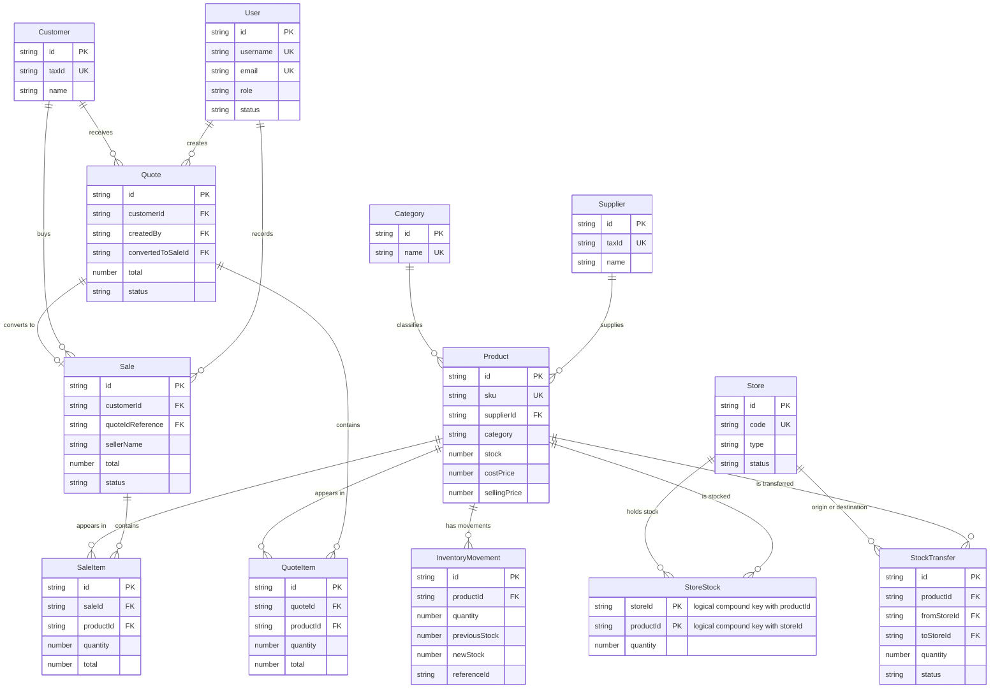

# Data Architecture & Persistence Layer

Phantom currently uses MongoDB as its operational store, with a local JSON
fallback and snapshot backup. The SQL file at
`C:\Users\mathi\Downloads\bd_phantom.txt` is a separate legacy/reference
design: it defines 16 relational tables and seed data, but it is not executed
by the Node.js backend and does not describe the live MongoDB collections.

## Database Configuration

| Service/Module | DB Type | Profile | Driver | Connection | Migration Tool |
|---|---|---|---|---|---|
| Backend persistence | MongoDB | Local test | `mongodb` Node.js driver | `mongodb://127.0.0.1:27017`, database `phantom_erp_test` | None; application snapshot synchronization |
| Backend fallback | JSON files | Local fallback/backup | Node.js filesystem API | `backend/data/db.json`, `backend/data/audit.json` | None |
| Legacy reference | MySQL | Not active | Not configured in backend | Database `bd_phantom` | SQL script only; not executed |

MongoDB writes use one client reused by the process. The application stores
domain collections plus singleton documents for settings and system state.

## Data Ownership per Service

| Service | Collections/entities owned | Persistence | Caching | Notes |
|---|---|---|---|---|
| ERP backend | products, categories, suppliers, customers, inventory_movements | MongoDB plus JSON snapshot | In-memory `DataStore` | Domain state is loaded into one application store and flushed to MongoDB |
| Inventory and stores | stores, store_stock, stock_transfers | MongoDB plus JSON snapshot | In-memory `DataStore` | `store_stock` uses a compound logical key encoded in `_id` |
| Sales and quotes | quotes, sales | MongoDB plus JSON snapshot | In-memory `DataStore` | Line items are embedded in quote/sale documents |
| Identity and audit | users, audit_logs | MongoDB plus local audit fallback | In-memory request/application state | JWT secret is externalized; passwords use scrypt for new or upgraded records |
| Configuration | company_settings, system_state | MongoDB singleton documents | In-memory `DataStore` | Both use `_id: "primary"` |

## Entity Model

<!-- mermaid-checked: every attribute is `<type> <name> [<key>] ["<description>"]` with at most one of PK/FK/UK, no \n in descriptions, no {} in descriptions, every relationship label is double-quoted -->

In MongoDB, `QuoteItem` and `SaleItem` are embedded arrays rather than
collections. The relationship labels above describe application-level
references, not database-enforced foreign keys.

## Key Repository Methods

| Service | Repository | Notable methods | Purpose |
|---|---|---|---|
| ERP backend | `DataStore` in `backend/src/dataStore.ts` | `initialize`, `flushPersistence`, `addProduct`, `updateProduct`, `deleteProduct` | Load, mutate, normalize, and persist the in-memory domain snapshot |
| Inventory | `DataStore` | `getStoreStock`, `adjustStock`, `createStockTransfer`, `confirmTransferReceipt`, `getInventoryMovements` | Manage global stock, store stock, transfers, and Kardex |
| Sales and quotes | `DataStore` | quote and sale creation/conversion methods | Persist embedded line items and financial totals |
| Mongo persistence | `backend/src/mongo.ts` | `loadDatabaseSnapshot`, `saveDatabaseSnapshot`, `saveAuditEvents`, `loadAuditEvents` | Map the snapshot to collections and provide local fallback |

## Caching Strategy

There is no external cache. `DataStore` keeps the active snapshot in memory for
the lifetime of the backend and serializes writes through a persistence queue.
MongoDB is the durable operational store; JSON files are fallback/snapshot
storage, not a second production authority.

## Data Ownership Boundaries

The current deployment uses one logical MongoDB database shared by the backend,
with collection boundaries rather than separate services or databases. Cross
entity relationships are application-managed through string identifiers.
Product stock is split between the product-level `stock` field and the
`store_stock` collection; transfers and movements provide operational history.
No MongoDB schema validator or foreign-key constraint was found.

### Data Classification & Sensitivity

| Entity | Sensitive fields | Classification | Controls in place |
|---|---|---|---|
| Customer | name, taxId, email, phone, address | PII | API authentication changes are present in the working tree; field encryption/masking not configured |
| Supplier | taxId, email, phone, address, contactPerson | PII | No field encryption/masking configured |
| User | username, email, password, role, permissions | PII/credential | JWT secret is externalized; new password hashes use scrypt; legacy/demo plaintext compatibility remains |
| Sale and Quote | customer snapshot fields, totals, payment status/method | PII/business data | API authorization is partial; no field encryption/masking configured |
| Audit log | actor identity, IP address, route, before/after values | PII/security telemetry | Sensitive key names are filtered from audit payloads; no encryption-at-rest configured |

## SQL Reference Comparison

The SQL reference contains these relational areas:

| SQL tables | Relational keys/relations | Current Mongo equivalent | Assessment |
|---|---|---|---|
| `roles`, `usuarios` | `usuarios.id_rol -> roles.id_rol` | `users.role`, `users.permissions` | Implemented with a simpler role value; no separate role collection |
| `clientes` | Customer primary key; unique document | `customers` | Implemented; fields are consolidated and use string IDs |
| `categorias`, `marcas`, `proveedores` | Product foreign keys to category, brand, supplier | `categories`, `Product.category`, `Product.brand`, `suppliers` | Category and supplier implemented; brand is denormalized text, no `brands` collection |
| `productos`, `inventario` | Product foreign keys; one inventory row per product | `products`, plus `store_stock` | Implemented and extended; global product stock plus per-store stock |
| `metodos_pago` | Payment lookup table | `Sale.paymentMethod` enum | Implemented as an enum, without lookup collection |
| `ventas`, `detalle_venta`, `pagos_ventas` | Sale to customer/user; detail and payment child tables | `sales` with embedded `items` | Implemented functionally; payment rows are reduced to payment fields, not separate documents |
| `pedidos`, `detalle_pedido` | Order to customer and product details | No dedicated order entity | Missing as a separate module; do not claim parity unless scope includes orders |
| `cotizaciones`, `detalle_cotizacion` | Quote to customer/user and product details | `quotes` with embedded `items` | Implemented functionally with additional lifecycle fields |
| `marcas` | Independent brand catalog | `Product.brand` | Changed/denormalized |
| `inventario` | Single stock row per product | `products.stock` and `store_stock` | Extended for multiple stores |

## Findings and Recommendations

1. `bd_phantom.txt` is a reference/seed script, not a migration source. It
   contains destructive `DROP DATABASE`, `CREATE DATABASE`, inserts, and
   verification queries. It must remain unexecuted.
2. The current Mongo model supports multiple stores: the code defines `stores`,
   `store_stock`, and `stock_transfers`; `store_stock` uses
   `<storeId>::<productId>` as a logical compound key. Add MongoDB indexes and
   validation later, but do not replace the working model with SQL tables.
3. Keep `products.stock` explicitly defined as global or warehouse stock in the
   documentation. Otherwise it can diverge from the sum of `store_stock`.
4. Add invariant checks for non-negative quantities, valid store/product
   references, transfer status transitions, and totals derived from line items.
5. Consider a `brands` collection only if brand CRUD, uniqueness, or reporting is
   required. The current `brand` field is sufficient for the present scope.
6. Preserve embedded quote/sale items because they retain historical prices and
   names. References to current products should be treated as informational.
7. Complete security hardening separately from this model audit. Do not copy
   the SQL seed passwords (`123456`) into MongoDB, and do not describe the
   unmerged OWASP branch as production behavior.
8. For APF3, present MongoDB as the actual persistence model, the SQL file as a
   historical reference, and include this diagram plus a collection/field
   dictionary. Record the observed test database separately from production
   `phantom_erp`.

## SQL Data Quality Issues

The script has inconsistencies that make automatic recovery unsafe:

- The second `cotizaciones` insert does not provide a value for every listed
  column and appears to place `599.80` where `fecha_vencimiento` is expected.
- Quote totals do not consistently match the sum of their detail rows.
- SQL users contain plaintext demo passwords.
- SQL uses separate detail and payment tables while the current application
  embeds line items and represents payment state in the sale document.
- SQL stock is single-location, so it cannot represent the current
  store-to-store stock model without additional tables and rules.

## APF3 Conclusion

The system to present is the MongoDB-backed Node.js/Express application using
`phantom_erp_test` for validation and `phantom_erp` as the intended main
database. The SQL script should be cited as an original conceptual model and
used to explain lineage and renamed/embedded entities, not executed or treated
as the current schema. No SQL data must be recovered unless a specific
business record is proven absent from the JSON/Mongo backups and is manually
validated before a separately approved import.
